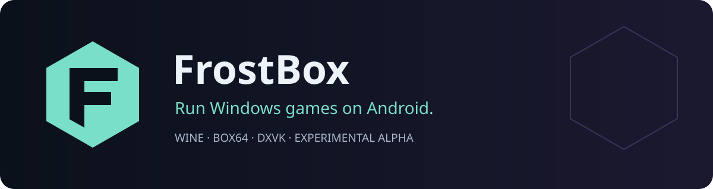
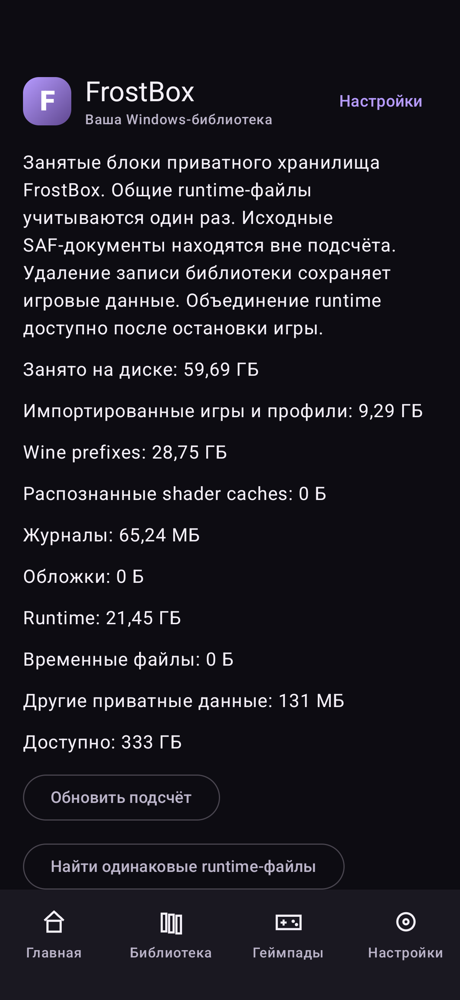
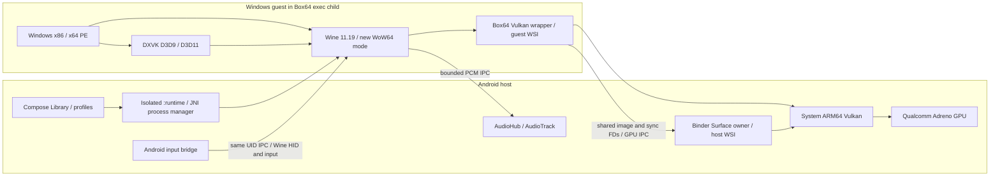

<p align="center"></p>

<p align="center"><strong>Experimental Windows Gaming Compatibility Layer for Android</strong><br />
<a href="README.ru.md">Русский</a> · <a href="README.md">English</a> · <a href="docs/COMPATIBILITY.md">Compatibility</a> · <a href="docs/BUILDING.md">Build</a></p>

<p align="center">


<a href="LICENSE"></a>
<a href="https://github.com/sqeezy-53/FrostBox/actions/workflows/build.yml">Android Checks</a>
</p>

## Overview

FrostBox runs selected Windows x86/x64 applications on ARM64 Android through Wine,
Box64 and optional DXVK. It provides its own Android launcher, process management,
private Wine prefixes, display transport, controller bridge and audio transport.
It runs under an ordinary app UID, without a Windows installation or root.

This is an engineering alpha, **not general Windows-game compatibility**. Its main
physical validation device is a POCO F8 Ultra with Android 16 and Adreno 840.
Other Android devices and drivers need separate qualification. Android 10 is the
minimum build target, not a promise that every runtime path works on Android 10.

## Why FrostBox

An independent Kotlin/Compose application and native runtime integration, built
around established open-source compatibility components. FrostBox is not a
Winlator fork. The focus is on observable execution, bounded resource use,
recoverable sessions and honest compatibility evidence.

## Key features

- In-game Game Panel and host Fit/Fill/Stretch, qualified with a real D3D11 fixture; [scope and limitations](docs/GAME_EXPERIENCE.md).

- Persistent Library and per-application profiles; explicit SAF import of EXEs and folders.
- Real Play/Stop, stdout/stderr, exit codes and isolated `:runtime` execution.
- Standard Wine prefixes, integrity checks, reuse and process-death recovery.
- Windows GDI, Unicode/IME and experimental Vulkan presentation through GPU IPC.
- Tested D3D11 x64 and D3D9 x86 paths using DXVK 2.7.1.
- Android gamepad diagnostics, mappings, deadzones and Wine HID/XInput transport.
- Tested Windows PCM output through a bounded Android AudioTrack bridge.

## Screenshots

<p align="center"></p>

Real Android UI captured on the validation device; only aggregate storage counts
are shown. The banner uses original vector app branding. Game scenes, private
Library entries and raw device logs are excluded.

## Architecture & how it works



WoW64 uses 32-bit Windows PE modules with the existing 64-bit Unix/Bionic Wine
userspace and Box64; it does not add an x86 Android ABI. Guest Vulkan calls use
Box64's native wrappers. Presentation imports shared GPU images into a separate
Android-owned swapchain. The GDI path remains independent.
[Detailed architecture](docs/ARCHITECTURE.md) · [Runtime boundaries](docs/RUNTIME.md).

## Compatibility

| Path / application | Confirmed scope | Remaining limit |
|---|---|---|
| Windows x64 / x86 WoW64 | Real device fixtures; console 5050 / exit 42 | Arbitrary applications unqualified |
| Vulkan compute | Windows fixture 10800 / exit 42; Android GPU | Extensions need individual validation |
| D3D9 / D3D11 | x86 D3D9 and x64 D3D11 Draw/Present fixtures | Driver/game dependent |
| KARLSON | Tutorial movement, camera and audible audio physically confirmed | Sandbox can fail with `VK_ERROR_DEVICE_LOST` |
| Mafia II (2010) | Main menu reached once; physical 8BitDo and music confirmed | Repeated startup unreliable; level/gameplay/FPS unqualified |

[Full compatibility matrix](docs/COMPATIBILITY.md). Fixtures and menu rendering do
not establish playable game support or sustained performance.

## Supported graphics APIs

Qualified test paths use system Qualcomm Vulkan with DXVK 2.7.1. GDI remains
available. D3D12 / VKD3D-Proton are not integrated. DirectDraw, D3D8 and D3D10 are
not qualified. No proprietary GPU driver or unverified Turnip build is bundled.

## Input & audio

A physical 8BitDo was verified through Android and Windows XInput 1.3/1.4/9.1.0,
including disconnect/reconnect. KARLSON uses the keyboard/mouse mapping path for
movement and relative camera input. The audio bridge supports tested shared
stereo 48 kHz PCM output; recording and arbitrary formats are not promised.

## Installation

There is no approved GitHub binary release yet. Existing qualified APK checkpoints
remain local until source correspondence and all distribution obligations are
checked. The current qualified Wine PE assets embed local build paths and are
not approved for GitHub binary upload. GitHub Actions produces a **shell-only debug APK**, not the full gaming
runtime. Do not install it over a full device build expecting Wine to remain bundled.
[Installation and safe upgrades](docs/INSTALLATION.md).

## Build from source

Use Linux, JDK 17, SDK 36, NDK 27.2.12479018, CMake 3.22.1 and the Gradle wrapper.
With Android SDK configured:

```sh
./gradlew :core:test :android-app:testDebugUnitTest :android-app:assembleDebug :android-app:lintDebug
cmake -S runtime/native -B build/native -G Ninja
cmake --build build/native
ctest --test-dir build/native --output-on-failure
```

The default build includes the application shell and original diagnostic fixtures.
Full Wine/Box64/DXVK packages are separately generated, hash-checked inputs.
They are not stored in Git, and the complete GPU build is not yet a one-command
clean-clone release recipe. [Build tiers and current prerequisites](docs/BUILDING.md).
CI success means host compilation/tests; it does not mean physical Android validation.

## Configuration

Import an owned EXE, explicitly import neighboring files when needed, then configure
working directory, argument array, prefix, runtime/API, input and audio in Details.
Import never launches code automatically. Existing prefixes are reused. Keep a
backup before testing experimental profiles. [Configuration](docs/CONFIGURATION.md).

## Known limitations

Foundation recovered **20.11 GiB** by sharing verified immutable PE/font data:
74.62 → 54.51 GiB immediately after reconciliation. After creating one retained
QA prefix and running regressions: 55.70 GiB. Games/prefixes were preserved.
Legacy diagnostic prefixes and old package versions remain protected; general
cache garbage collection is still pending. Mafia II startup and KARLSON
scene transitions remain unresolved. No sustained gaming FPS/frametime results
are claimed. [Known issues](docs/KNOWN_ISSUES.md) · [Storage](docs/STORAGE.md).

## Roadmap

1. Finish safe cache lifecycle/GC on top of verified immutable runtime sharing.
2. In-game panel and persistent display scaling with stable Surface lifecycle.
3. Repeatable Mafia II startup and KARLSON scene-transition diagnosis.
4. Wider physical-device qualification and audited binary prereleases.

## Contributing

Start with [CONTRIBUTING](CONTRIBUTING.md), [branch/release workflow](docs/DEVELOPMENT.md)
and [security policy](SECURITY.md). Report tested behavior and sanitized logs;
do not submit game files, prefixes, credentials or device identifiers.

## License, third-party components & credits

Original FrostBox code is [MIT](LICENSE). Wine-derived drivers and changes retain
LGPL-2.1-or-later; Box64, DXVK, FreeType, AndroidX and tooling retain their own
licenses. **The complete runtime APK is not licensed solely under MIT.**
[Third-party notices](THIRD_PARTY_NOTICES.md) · [corresponding-source requirements](third-party/SOURCE_BUNDLE.md).

Thanks to the Wine, Box64, DXVK, FreeType, Android and Vulkan projects. FrostBox is
independent and is not endorsed by them. No game, PhysX installer, proprietary GPU
driver or Windows system installation is distributed in this source repository.
