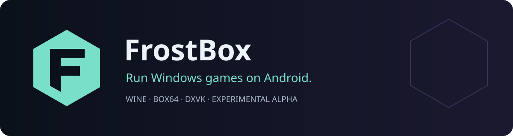

<p align="center"></p>

<p align="center"><strong>Экспериментальный слой совместимости Windows-игр для Android</strong><br />
<a href="README.ru.md">Русский</a> · <a href="README.md">English</a> · <a href="docs/COMPATIBILITY.md">Совместимость</a> · <a href="docs/BUILDING.md">Сборка</a></p>

<p align="center">Android 10+ / ARM64 · Kotlin / C++20 · Experimental Alpha · <a href="LICENSE">MIT для собственного кода</a> · <a href="https://github.com/sqeezy-53/FrostBox/actions">CI</a></p>

## Обзор

FrostBox запускает отдельные Windows x86/x64 приложения на ARM64 Android через
Wine, Box64 и опциональный DXVK. Собственные компоненты: Android-лаунчер,
управление процессами и Wine prefix, вывод изображения, ввод и передача звука.
Приложение работает под обычным Android UID без root и полноценной Windows.

Это инженерная alpha, **а не универсальная совместимость со всеми играми**.
Основная проверенная платформа — POCO F8 Ultra, Android 16, Adreno 840.
Другие устройства требуют отдельных проверок. Android 10 — минимум сборки,
а не обещание работы всех runtime на этой версии Android.

## Зачем FrostBox

Самостоятельное приложение Kotlin/Compose и нативная интеграция существующих
open-source компонентов; проект не является форком Winlator. Приоритеты —
реальное исполнение, восстановление сессий, контролируемые ресурсы и проверяемые
результаты вместо обещаний совместимости.

## Возможности

- Сохраняемая Library, профили игр и явный SAF-импорт EXE и каталогов.
- Настоящие Play/Stop, stdout/stderr, exit code и отдельный процесс `:runtime`.
- Штатные Wine prefixes, проверки целостности и восстановление после остановки.
- GDI, Unicode/IME и экспериментальный Vulkan Present через GPU IPC.
- Проверенные пути DXVK 2.7.1: D3D11 x64 и D3D9 x86.
- Диагностика Android-геймпадов, mapping/deadzones и Wine HID/XInput bridge.
- Проверенный PCM output Windows → Android AudioTrack с ограниченными буферами.

## Скриншоты

Безопасная галерея реальных UI-скриншотов ещё готовится. Баннер использует
собственный знак Android-приложения и не изображает gameplay. Приватные экраны
библиотеки, игровые ресурсы и необработанные журналы не публикуются.

## Архитектура и исполнение

Library → IPC/JNI → Wine 11.19 / новый WoW64 → Box64. D3D9/D3D11 переводит DXVK;
Vulkan вызывает системный ARM64 loader через wrappers Box64. Для Present гостевые
GPU images передаются через shared memory/sync FD владельцу Android Surface в
`:runtime`. Это отдельный путь от GDI. Аудио передаётся ограниченным PCM IPC в
AudioTrack; ввод — в существующий Wine input/HID backend.

WoW64 использует 32-битные Windows PE и 64-битный Unix/Bionic userspace Wine;
32-битная Android ABI не добавляется.
[Диаграмма](README.md#architecture--how-it-works) · [Подробная архитектура](docs/ARCHITECTURE.md).

## Совместимость

| Путь / приложение | Подтверждено | Ограничения |
|---|---|---|
| Windows x64 / x86 WoW64 | Реальные fixtures, console 5050 / exit 42 | Произвольные EXE не квалифицированы |
| Windows Vulkan compute | GPU-вычисление 10800 / exit 42 | Extensions проверяются отдельно |
| D3D9 / D3D11 | x86 D3D9 и x64 D3D11 Draw/Present | Зависимость от драйвера и приложения |
| KARLSON | Пользователь подтвердил Tutorial: движение, камеру, звук | Sandbox может завершаться `VK_ERROR_DEVICE_LOST` |
| Mafia II (2010) | Меню достигнуто один раз; физически подтверждены 8BitDo и музыка | Повторный старт нестабилен; уровень, gameplay и FPS не подтверждены |

[Полная таблица](docs/COMPATIBILITY.md). Fixture или меню не доказывают играбельность.

## Графические API

Проверенные пути используют системный Qualcomm Vulkan и DXVK 2.7.1. GDI сохранён.
D3D12/VKD3D-Proton не интегрированы. DirectDraw, D3D8 и D3D10 не квалифицированы.
Проприетарные драйверы и непроверенный Turnip не включены.

## Ввод и звук

Физический 8BitDo проверен через Android и Windows XInput 1.3/1.4/9.1.0,
включая reconnect. Для KARLSON подтверждён keyboard/mouse mapping с относительным
движением камеры. Аудио ограничено проверенным shared stereo PCM 48 kHz;
запись и произвольные форматы не обещаются.

## Установка

Проверенного бинарного GitHub Release пока нет. Существующие APK checkpoints
сохранены локально до проверки исходников и обязательств распространения.
CI собирает **APK оболочки без полного игрового runtime**. Не устанавливайте его
поверх полной device-сборки в ожидании сохранения встроенного Wine.
[Установка и безопасное обновление](docs/INSTALLATION.md).

## Сборка

Linux, JDK 17, SDK 36, NDK 27.2.12479018, CMake 3.22.1 и Gradle wrapper.
После настройки SDK:

```sh
./gradlew :core:test :android-app:testDebugUnitTest :android-app:assembleDebug :android-app:lintDebug
cmake -S runtime/native -B build/native -G Ninja
cmake --build build/native
ctest --test-dir build/native --output-on-failure
```

Полные Wine/Box64/DXVK runtime генерируются отдельно и проверяются по хешам;
в Git они не включены. Полная GPU-сборка пока требует подготовленных inputs,
единой clean-clone команды выпуска ещё нет.
[Уровни сборки](docs/BUILDING.md). Зелёный CI не означает проверку на POCO.

## Настройки

Добавьте собственный EXE и явно импортируйте соседние файлы при необходимости.
В Details задаются рабочий каталог, массив аргументов, prefix, runtime/API,
ввод и звук. Импорт не запускает EXE автоматически; prefix переиспользуется.
[Настройка профиля](docs/CONFIGURATION.md).

## Ограничения и планы

Полные копии overlay и оставшиеся диагностические prefixes привели к расходу
74,61 GiB на устройстве разработки. Безопасное разделение immutable runtime и
контролируемая очистка — текущая задача; массового удаления нет.
Повторяемость Mafia II и переходы сцен KARLSON остаются открытыми.
Длительные FPS/frametime не измерены.

Следующие этапы: storage lifecycle, игровая панель и сохраняемое масштабирование,
стабилизация игр, расширение device-проверок и проверенный бинарный prerelease.
[Проблемы](docs/KNOWN_ISSUES.md) · [Хранилище](docs/STORAGE.md).

## Участие, лицензии и авторство

[CONTRIBUTING](CONTRIBUTING.md) · [Ветки и версии](docs/DEVELOPMENT.md) · [SECURITY](SECURITY.md).
Не присылайте игровые файлы, prefixes, credentials и приватные идентификаторы.

Собственный код FrostBox — [MIT](LICENSE). Производные Wine-модули сохраняют
LGPL-2.1-or-later; Box64, DXVK, FreeType и Android-компоненты — свои лицензии.
**MIT не описывает лицензию всего runtime APK.**
[Third-party notices](THIRD_PARTY_NOTICES.md) · [Corresponding source](third-party/SOURCE_BUNDLE.md).

Спасибо проектам Wine, Box64, DXVK, FreeType, Android и Vulkan. FrostBox не связан
с ними организационно. Игры, PhysX MSI и проприетарные драйверы не распространяются.
